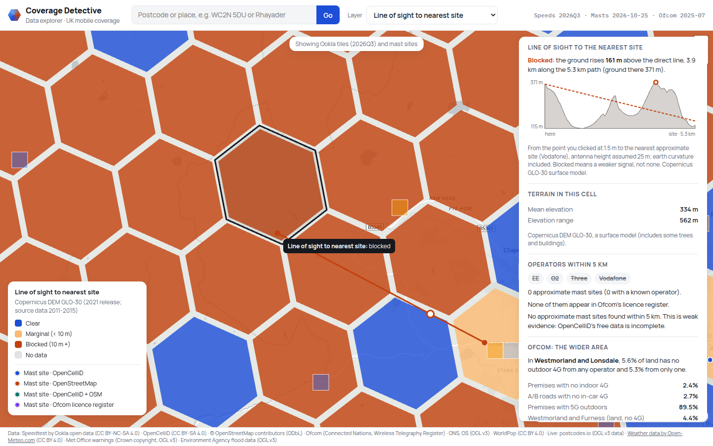
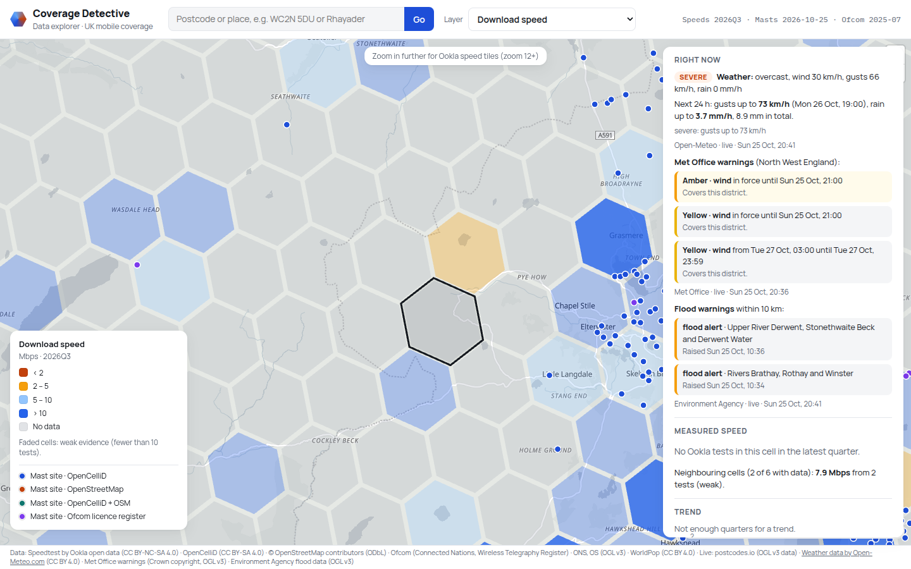
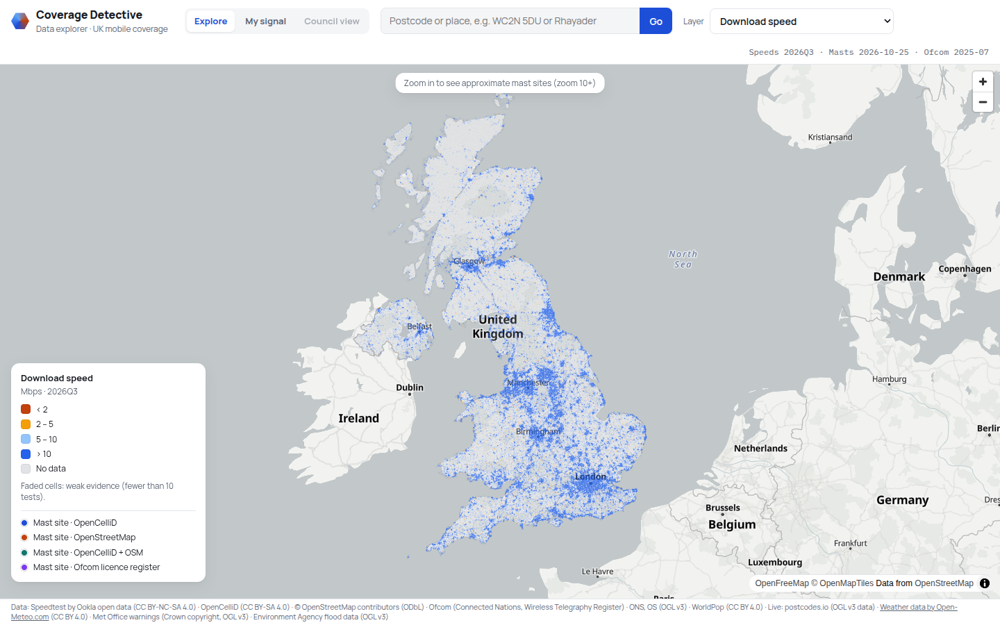

# Coverage Detective

Explains why mobile signal is poor at a UK location using public data (measured speeds,
mast locations, terrain, Ofcom coverage, weather), and ranks coverage gaps for operators
and councils. Data is queried through Zetaris.

## Setup

```bash
python3 -m venv .venv
.venv/bin/pip install -r requirements.txt
cp .env.example .env   # fill in Zetaris, OpenCelliD and (optionally) Ofcom settings
```

Put the two input files in place:

- `data/raw/boundary/uk_countries.geojson`: ONS *Countries Boundaries UK* (all four nations)
- `data/raw/population/population.tif`: WorldPop UK population raster

## Zetaris

All data is queried through [Zetaris](https://www.zetaris.com) running locally in Docker
(the `zetaris-platform` bundle, default `~/zetaris-platform`; start it with its own
README and check with its `./verify.sh`).

1. **Settings** in `.env`: `ZETARIS_URL=http://localhost:3000` (the Zetaris web app; the
   client signs in there and sends SQL through its API proxy), `ZETARIS_USER`,
   `ZETARIS_PASSWORD`.
2. **Mount our data into Zetaris.** Zetaris only reads local files under
   `/home/zetaris/customer-data/shared/` inside its query engine; any other path fails
   with `Invalid file path to access`. `zetaris/docker-compose.coverage.yml` mounts
   `data/processed` there read-only, as `coverage_detective/`. Apply it with the wrapper,
   which passes that file after Zetaris's own `docker-compose.yml` (nothing in the
   zetaris-platform folder is changed):

   ```bash
   scripts/zetaris/compose.sh up -d driver
   ```

   Use `scripts/zetaris/compose.sh` instead of a plain `docker compose` from then on: a
   plain `docker compose up -d` in zetaris-platform recreates the driver without the mount.
   Set `ZETARIS_PLATFORM_DIR` if the bundle is elsewhere.
3. **Register the sources** (after building the data; re-runnable):

   ```bash
   .venv/bin/python scripts/zetaris/register_sources.py
   .venv/bin/python scripts/check_data.py      # cross-source checks through Zetaris
   ```

Each dataset is its own Zetaris source (Lightning database), e.g. `CD_CELLS.cells_r7`,
`CD_OOKLA_MOBILE.ookla_mobile_r7`. Code queries them with
`coverage_detective.data.zetaris.query(sql)`; every query is logged to
`logs/zetaris_queries.jsonl` (time, SQL, duration, rows, error) for the evidence trail.

## Data sources

| Source | What it tells us | Type | Licence | Date / version |
|---|---|---|---|---|
| WorldPop + ONS boundaries | People per cell; nation | file | CC BY 4.0; OGL v3.0 | 2020; ONS Dec 2023 |
| Ookla open data (mobile) | Measured mobile download/upload/latency, tests, devices, trend | file | CC BY-NC-SA 4.0 | 2026Q3 + 3 previous quarters |
| OpenCelliD | Crowd-sourced radio cells → approximate mast sites, operators *inferred* from network codes | file | CC BY-SA 4.0 | downloaded 25 Oct 2026 |
| OpenStreetMap (Geofabrik) | Mapped communication masts and towers | file | ODbL 1.0 | downloaded 25 Oct 2026 |
| Ofcom Wireless Telegraphy Register | Operators' licensed microwave links: operators *confirmed* at sites, antenna heights | file | Ofcom copyright, free re-use | downloaded 25 Oct 2026 |
| Ofcom Connected Nations | Predicted coverage by number of operators, per constituency / local authority; per operator by nation | file | OGL | July 2025 |
| ONS constituencies, local authorities | Which area a cell is in | file | OGL v3.0 | July 2024; Dec 2024 |
| Copernicus DEM GLO-30 | Elevation per cell; line of sight to mast sites | file (93 tiles) | Copernicus DEM licence (free, attribution) | 2021 release (data 2011–2015) |
| postcodes.io | Postcode / place → location, district, region; nearest postcode to a point | REST, live (Python client) | OGL v3 data (ONS, OS, Royal Mail) | at question time |
| Open-Meteo forecast | Weather now and next 24 h (rain, snow, wind, gusts) → severity | REST, live (Python client) | CC BY 4.0, non-commercial, attribution | at question time |
| Met Office severe weather warnings (RSS) | Yellow / amber / red warnings for the point's region | RSS, live (Python client) | Crown copyright, OGL v3 | at question time |
| Environment Agency flood monitoring | Flood alerts / warnings within 10 km (England only) | REST, live: Python client + Zetaris REST source `CD_LIVE_EA_FLOODS` | OGL v3 | at question time |

Details, processing steps and exact licences: `data/README.md`.

## Build the data

```bash
.venv/bin/python scripts/process/build_cells.py   # H3 r7 grid with population and nation
.venv/bin/python scripts/download/ookla.py        # Ookla mobile tiles, UK only, last 4 quarters
.venv/bin/python scripts/process/build_ookla.py   # Ookla speeds per cell + trend
.venv/bin/python scripts/download/opencellid.py   # OpenCelliD UK cells (needs OPENCELLID_TOKEN)
.venv/bin/python scripts/download/osm.py           # OpenStreetMap GB + Ireland extracts (~2.6 GB)
.venv/bin/python scripts/process/build_masts.py   # mast sites + nearest mast / operators per cell
.venv/bin/python scripts/download/ofcom_wtr.py     # Ofcom Wireless Telegraphy Register (~54 MB)
.venv/bin/python scripts/process/build_wtr.py      # register points, merged into the mast sites
.venv/bin/python scripts/download/dem.py           # Copernicus DEM GLO-30 tiles (~1.4 GB)
.venv/bin/python scripts/download/ons_boundaries.py # ONS constituency + local authority boundaries
.venv/bin/python scripts/process/build_ofcom.py    # Ofcom July 2025 area coverage per cell (zip in data/raw/ofcom/)
```

Every script can be re-run safely; pass `--force` to rebuild an existing output.

## Data explorer

A map of every layer, for looking at the data before the agents exist.

```bash
.venv/bin/python scripts/process/build_web_layers.py   # precompute map layers -> data/web/layers/
scripts/zetaris/compose.sh up -d                        # Zetaris with our data mount (cell details use it)
.venv/bin/python run.py                                 # http://localhost:8000
```

- Hexagons (H3 r7) coloured by the chosen layer: download speed (< 2, 2–5, 5–10, > 10
  Mbps), tests, speed trend, population, nearest mast site, operators within 5 km,
  operator data status, Ofcom land with no / one 4G operator, elevation range, line of
  sight to the nearest site (clear / marginal / blocked). Cells with fewer than 10
  tests are faded (weak evidence); grey means no data.
- Approximate mast sites appear from zoom 10 (coloured by source), Ookla tiles from zoom 12.
- Click a cell: its details come from **one cross-source Zetaris query** (cells, Ookla and
  history, neighbours, masts, Ofcom area), shown under "Zetaris query used", with data dates.
- Line of sight in the cell panel is computed from the **exact point** you clicked or
  searched (not the cell centre) to the nearest approximate site: the line is drawn on the
  map (red if blocked, with the highest obstruction marked) above an elevation profile of
  the path. The "Line of sight" map layer is a per-cell summary from each cell's centre.
- "Right now" in the cell panel: live weather (with severity), Met Office warnings for the
  region and EA flood warnings within 10 km ("not covered" outside England), each with its
  source, status (live / cached / sample) and time. If everything is calm it says so.
- Search a postcode or place (postcodes.io). Works on phones (the panel slides up).

API: `GET /api/layers`, `/api/layer/{name}`, `/api/masts?bbox=`, `/api/tiles?bbox=`,
`/api/cell/{cell_id}`, `/api/geocode?q=`, `/api/geocode/reverse?lat=&lon=`,
`/api/live?lat=&lon=` (add `&flood_via=zetaris` for the Zetaris path),
`/api/los?lat=&lon=` (line of sight from the exact point to the nearest site, or
`&site_id=`), `/health`
(OpenAPI docs at `/docs`).




Screenshots: `pip install playwright`, then `python scripts/screenshots.py` (pass
`--chrome <path>` to use an installed Chromium) → `docs/screenshots/`.



## Evidence API

`POST /api/evidence` with `{"query": "WC2N 5DU"}` (postcode or place) or `{"lat": 54.445,
"lon": -3.105}` returns the evidence bundle the agents will work from
(`coverage_detective/evidence.py`):

- the point, its H3 r7 cell and the six neighbours;
- three Zetaris queries, each logged in the bundle (`zetaris_queries`: SQL, time, rows):
  Q1 the cross-source cell query (cells, Ookla with history and neighbours, masts, Ofcom
  area, terrain, line of sight), Q2 approximate mast sites within 10 km of the exact point,
  Q3 UK context (median devices per head and speed; cached per process);
- line of sight from the exact point to the nearest site of each operator within 10 km,
  and to the nearest site of any operator;
- live weather, Met Office warnings and EA flood warnings.

Each item has `id`, `source`, `data_period`, `as_of`, `query_or_url`, `cell_ids`,
`finding` (one plain-English sentence built in code, following the wording rules in
CLAUDE.md), `value`, `sample_size`, `strength` (strong / moderate / weak) and `bears_on`
(the causes it is relevant to). The bundle also carries `errors`, `limitations` and the
Ofcom coverage checker link for residents.

Strength, in short: Ookla speed is strong from 50 tests, weak under 10; line of sight is
strong when blocked by 30 m or more, weak when the margin is under 10 m (trees or buildings
in the surface model) or under 1 m of clearance; "no sites found" and operator gaps are weak
(crowd-sourced data is incomplete); unknown-operator sites weaken the operator item unless
all four operators are present; live items are weak when served from a sample.

```bash
.venv/bin/python scripts/check_evidence.py     # readable bundles for the 3 sample places
curl -s -X POST localhost:8000/api/evidence -H 'content-type: application/json' -d '{"query": "LD6 5AD"}'
```

Saved bundles for the sample places are in `data/samples/evidence/` (for agent tests).

## Data freshness

Two kinds of data:

- **Live, fetched when a question is asked:** postcode lookup (postcodes.io), weather
  (Open-Meteo), Met Office weather warnings and Environment Agency flood warnings. Their
  evidence is stamped with the fetch time. Clients (`coverage_detective/sources/`) use a
  5 s timeout, one retry and a disk cache (`data/cache/live/`, gitignored; postcodes 30
  days, weather 30 min, warnings and floods 15 min). If a call fails they use the cached
  copy, else a saved sample (`data/samples/`), and say which. `SAMPLE_MODE=true` answers
  from the samples only (offline, reproducible); refresh them with
  `python scripts/download/live_samples.py`. Check: `python scripts/check_live.py`.
- **Stored, refreshed periodically** and queried through Zetaris:

  | Source | Refreshed | How |
  |---|---|---|
  | Ookla mobile speeds | quarterly | when a newer quarter appears in the public bucket |
  | OpenCelliD radio cells | weekly | re-download |
  | OpenStreetMap masts | monthly | re-download the Geofabrik extracts |
  | Ofcom Wireless Telegraphy Register | monthly | re-download the CSV |
  | Ofcom Connected Nations | each release (about twice a year) | download the new zip by hand into `data/raw/ofcom/` (no API) |
  | WorldPop population, ONS boundaries, Copernicus DEM | manual | rarely change |

`data/manifest.json` (committed) records for every stored source its data period (e.g.
Ookla `2026Q3`), download dates, build time, refresh cadence and each output's row count
and SHA-256; every build script updates it. Evidence items carry `data_period` and
`as_of` from the manifest (`coverage_detective.data.manifest.evidence_meta`), or the fetch
time for live sources.

```bash
.venv/bin/python scripts/refresh.py --check-only          # what is due
.venv/bin/python scripts/refresh.py                       # refresh what is due
.venv/bin/python scripts/refresh.py --source ookla --force
```

A refresh downloads the new data (keeping the old file until the new one is in), rebuilds
the affected tables, re-registers them in Zetaris and updates the manifest.

## Tests

```bash
.venv/bin/python -m pytest -q
```

Data sources and licences: see `data/README.md`.

## Limitations

- Causes are inferred from public data, not confirmed: operators' network data isn't public.
- Ookla speeds are quarterly aggregates with no time-of-day detail, so congestion can only
  be inferred indirectly (as "capacity strain").
- No address-level Ofcom coverage: the Ofcom API isn't available to us. Residents are
  pointed to Ofcom's [mobile coverage checker](https://www.ofcom.org.uk/mobile-coverage-checker).
- OpenCelliD mast data is crowd-sourced and incomplete, with approximate positions, so
  "no masts found" is weak evidence. Operator labels come from network codes and follow
  the reference table; networks have merged in recent years.
- Line of sight (terrain): "blocked" means the ground rises above the straight line to the
  site, so the signal is likely weaker (it bends over the ridge), not absent. Most antenna
  heights are assumed (25 m): Ofcom's register gives heights only for sites with licensed
  microwave links (40% of cells' nearest sites). Copernicus GLO-30 is a surface model: it
  includes some trees and buildings, so it is most reliable for hills and valleys; small
  obstructions (< 10 m, "marginal") may be woodland or buildings. Fresnel-zone clearance
  and indoor loss are not modelled.
- Mobile networks only; home broadband is out of scope.

## Future work

- Power cuts as a cause (`active_incident`): the distribution network operators publish
  outages in different formats; dropped for the hackathon.
- Flood warnings for Scotland (SEPA), Wales (NRW) and Northern Ireland (DfI Rivers).
